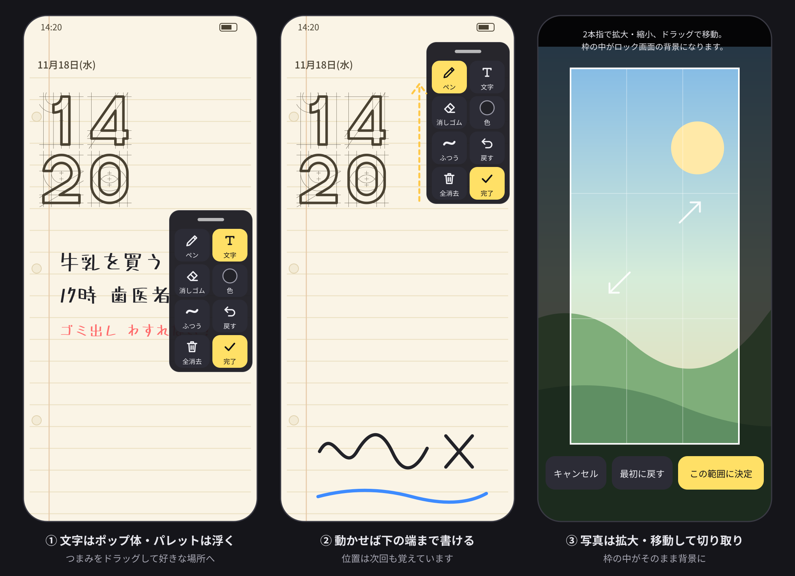

# ロック画面メモ（LockMemo）

Android のロック画面の上に、手書きや文字のメモを出しておけるアプリです。
画面を点けるだけでメモが目に入り、ロックを解除しないまま書き足したり消したりできます。

*An Android app that shows a handwritten / typed memo on top of your lock screen. You can write and erase without unlocking. The app UI is in Japanese.*



（上の画像はイメージ図です）

## できること

- **手書き**：ペン（6色・太さ3段階）、消しゴム、1つ戻す、全消去
- **文字入力**：好きな場所に置けます。大きさはスライダーで自由に変えられます
- **背景を選べる**：クリーム／白のルーズリーフ、方眼、クリーム方眼、真っ白、真っ黒、好きな写真
- **写真の切り取り**：背景の写真は、拡大・縮小・移動して使う範囲を決められます
- **時計**：日付と時刻を表示（オフにもできます）
- **道具パレットは動かせる**：つまみをドラッグして好きな場所へ。画面の下の端まで書けます
- **文字のフォントを選べる**：端末にあるフォントファイル（.ttf / .otf）を読み込めます
- **通知や音楽はいつものロック画面で**：メモを上にスワイプすると、メモが上へ片付いていつものロック画面が出ます。音楽の再生中はメモを出さない設定もできます
- **更新のお知らせ**：新しい版が公開されると通知で知らせます
- ロックを解除するとメモは消え、ホーム画面には残りません

対応：Android 8.1 以上

> 個人が趣味で作っているアプリです。作者の OPPO の端末で使いながら作っており、ほかの機種での動作は確かめられていません。うまく動かない場合は Issues で教えてください。

## インストール

1. このページ右側の **Releases** を開き、一番新しい `LockMemo.apk` をダウンロードします
2. ダウンロードしたファイルを開きます。「提供元不明のアプリ」の許可を求められたら許可します
3. インストールが終わったらアプリを開きます

Google Play では配布していません。

## はじめの設定

アプリを開いて、上から順に進めます。

1. **他のアプリの上に重ねて表示** を許可する（必須。ロック画面にメモを出すために使います）
   - スイッチが押せない・「制限付き設定」と出るときは、アプリ内の「アプリ情報を開く」→ 右上のメニュー →「制限付き設定を許可」を先に押してください
2. **背景** を選ぶ（写真にする場合は「写真を選ぶ」→ 使う範囲を決める）
3. **時計** を出すかどうか選ぶ
4. **文字のフォント** を読み込む（しなくても使えます）
5. **「開始する」** を押し、**通知を許可** する（片付けたメモを通知から呼び戻すのと、更新のお知らせに使います）
6. 画面を一度消して点け直すと、ロック画面にメモが出ます

## 使い方

| 操作 | 内容 |
| --- | --- |
| ペンのボタン（右下） | 書くモードに入る。道具パレットが出ます |
| パレット上部のつまみ | ドラッグでパレットを移動（位置は覚えます） |
| ペン / 文字 / 消しゴム | 道具の切り替え |
| 色 / 太さ | 押すたびに切り替え（ペンと消しゴムの太さ） |
| 文字 | 置きたい場所をタップ → 入力。入力欄の下のスライダーで大きさを変更 |
| 戻す / 全消去 | 直前の1操作を取り消す ／ 2回押すと全部消す |
| 完了 | 保存して見るだけのモードに戻る（画面を消しても自動で保存されます） |
| 上にスワイプ | メモを上へ片付けて、いつものロック画面（通知・音楽）を表示 |
| 鍵のボタン（下中央） | 指紋・PIN などでロックを解除 |
| 戻るジェスチャー | メモを閉じて、いつものロック画面を表示 |

## 通知・音楽を見るには

このアプリは、いつものロック画面の上にメモの画面をかぶせて表示します。そのため、通知の一覧や音楽の操作はメモの下に隠れます。

- メモの画面を **上にスワイプ** すると、メモが上へ片付いて、いつものロック画面が出ます（途中で下へ戻せばメモも戻ります）
- 片付けたメモは、通知の「ロック画面メモ」を押すか、次に画面を点けたときに戻ります
- Android の決まりで、ふつうのアプリはいつものロック画面の上に何も置けません。そのため、片付けたメモの端をロック画面に残しておくことはできません
- **音楽などの再生中はメモを出さない** 設定があります（初期設定はオン）。再生中はいつものロック画面がそのまま出るので、再生の操作ができます

## 更新について

- アプリは 6 時間に 1 回まで、このリポジトリの Releases を確認し、新しい版があれば通知で知らせます
- 通知（またはアプリ内の「新しい版をダウンロード」）を押すと、ブラウザーで `LockMemo.apk` が開きます。ダウンロードしてインストールすると上書きで更新され、メモや設定はそのまま残ります
- アプリが勝手にファイルをダウンロードしたりインストールしたりすることはありません
- お知らせは、アプリ内の「⑥ アプリの更新」でオフにできます

### インストール時に警告が出る場合

Google Play 以外から入れるアプリなので、端末やセキュリティ機能によっては「提供元不明」「確認されていないアプリ」などの注意が出ることがあります。
このアプリが何をするかは、このリポジトリのソースコードですべて確認できます。心配な場合はインストールしないでください。

## 文字のフォントについて

文字入力用のフォントはアプリに同梱していません。好きなフォントのファイル（.ttf / .otf）を端末に保存して、
アプリ内の「④ メモの文字フォント」→「フォントファイルを選ぶ」で読み込んでください。
読み込まない場合は端末の標準フォントで表示されます。フォントの利用条件は、それぞれの配布元で確認してください。

たとえば「全員集合！ポップ体」（[配布ページ](https://mikannnoki-font.booth.pm/items/4356584)）のようなフリーフォントが使えます。

## プライバシーと注意

- **ロック画面に書いた内容は、端末を手に取った人なら誰でも見られ、書き換えたり消したりもできます。** 見られて困ることは書かないでください
- メモ・写真・設定は端末の中だけに保存され、どこにも送信されません
- 通信するのは、新しい版が出ていないかを確認するための GitHub（`api.github.com`）だけです。広告や解析の仕組みは入っていません
- 「ユーザー補助（アクセシビリティ）」の権限は使いません
- 着信中・通話中はメモを表示しません

使う権限：他のアプリの上に重ねて表示、通知、起動時に実行、フォアグラウンドサービス、インターネット（更新の確認用）

## うまく動かないとき

- **しばらくするとメモが出なくなる**：メーカーの省電力機能がアプリを止めていることがあります（OPPO・Xiaomi など）
  - 設定 → アプリ → ロック画面メモ で「自動起動」を許可し、バッテリー使用量で「バックグラウンドアクティビティを許可」をオンにする
  - 電池の最適化の対象から外す（アプリ内にボタンがあります）
  - 最近使ったアプリの画面で、このアプリをロック（固定）する
- **メモが出るのが一瞬遅い**：上の許可をすると改善することがあります
- **明るい写真で白い線が見えにくい**：ペンの色を変えてください

## 開発する人へ

ふつうの Android プロジェクトです（Java、外部ライブラリなし）。Android Studio で開いてそのままビルドできます。

- `main` に push すると GitHub Actions（`.github/workflows/build.yml`）が正式ビルド（release）を作り、Releases に `LockMemo.apk` を公開します
- 署名鍵はリポジトリに入れていません。Actions の Secret `KEYSTORE_BASE64`（鍵ファイルを base64 にしたもの）から復元します。
  Secret が無い場合は開発用の鍵でビルドだけ行い、リリースは作りません
- バージョン番号はビルドのたびに自動で上がります（`1000 + 実行番号`）

### フォークして自分用に配布する場合

アプリは「ビルドされたリポジトリ」の Releases を見て更新を知らせるので、フォークは自動的に自分のリポジトリを見に行きます。
自分の署名鍵を作って Secret に登録してください。

```sh
keytool -genkeypair -keystore release.keystore -storetype PKCS12 \
  -storepass lockmemo -keypass lockmemo -alias lockmemo \
  -keyalg RSA -keysize 2048 -validity 10000 -dname "CN=LockMemo"
base64 -w0 release.keystore   # この出力を Secret「KEYSTORE_BASE64」に登録
```

パスワードを変えた場合は、Secret `KEYSTORE_PASSWORD` にも登録します。`applicationId`（`app/build.gradle`）も自分のものに変えてください。

### ファイル構成

```
app/src/main/java/io/github/yugosandboxcoder/lockmemo/
  NoteActivity.java     ロック画面の上に出るメモ画面
  DrawView.java         手書き・文字・消しゴムのキャンバス
  BackgroundView.java   背景の表示 ／ Backgrounds.java 背景の描画
  ClockView.java        時計
  CropActivity.java     写真の切り取り画面 ／ CropView.java 拡大・移動できる切り取りビュー
  LockMemoService.java  画面の点灯・消灯を見て、メモ画面を出す常駐サービス
  BootReceiver.java     再起動後・更新後に常駐サービスを再開
  Updater.java          新しい版の確認とお知らせ
  Fonts.java            文字フォントの読み込み
  MainActivity.java     設定画面
  Prefs.java            設定値の保存
```

## ライセンス

- このアプリのソースコード：[MIT License](LICENSE)
- 時計のフォント「Auxiliary line」（© とりしっぽ）：SIL Open Font License 1.1（[third_party/Auxiliaryline/OFL.txt](third_party/Auxiliaryline/OFL.txt)）
